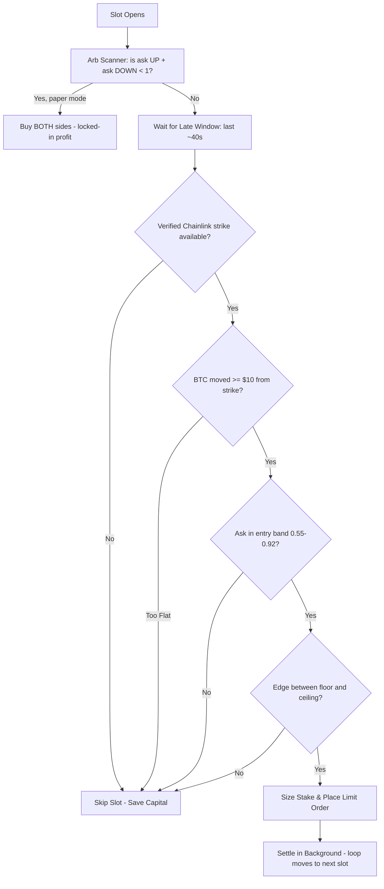

# Polymarket BTC 5-Minute Trading Bot: Beginner's Guide

This guide is designed to help a beginner understand how the Polymarket BTC 5-Minute UP/DOWN bot works, how to configure the strategy settings safely, and how to set up and fund a wallet for live trading.

---

## 1. How the Bot Works

Every 5 minutes, Polymarket hosts a contract: **"Will Bitcoin be UP or DOWN at the end of this 5-minute slot?"**

Since 2026-07-17 the bot runs a **single strategy — Late Momentum** — plus a
**sum-to-one arbitrage scanner** that watches the order book alongside it. The
old `mid`, `late_scalp`, `late_every`, and `hybrid` strategies were retired
because the permanent trade archive showed they lost money live (or only
"won" because of simulation bugs). Any old `STRATEGY` value is automatically
converted to `late_momentum`.



The bot's job each slot is to:
1. **Scan for arbitrage:** At any point with ≥20s left, if the UP ask plus the DOWN ask is under $1, buy **both** sides — one of them always pays $1/share, so the profit is locked in regardless of the outcome. (Paper mode only; in live mode arb signals are just logged.)
2. **Wait for the late window:** Momentum trades only happen in roughly the last 40 down to 8 seconds of the slot, when the direction is mostly decided.
3. **Verify the strike:** The slot-open price must come from the Chainlink Data Stream (the same oracle Polymarket uses to resolve the market). No verified strike → no trade.
4. **Confirm momentum:** BTC must have moved at least $10 (configurable) away from the strike. The bot buys the side the move points to (UP on a pump, DOWN on a dump).
5. **Check the price and the edge:** The ask must sit in a sane entry band (0.55–0.92), and the model edge must be above the floor **and below the ceiling** — a huge apparent edge in the final seconds usually means the model is wrong, not the market.
6. **Settle in the background:** After placing a trade, the bot doesn't sit idle — settlement (waiting for the official Polymarket outcome) runs as a background task while the main loop analyzes the next slot. A slot with an open trade is never entered twice.

---

## 2. Setting Up Your Wallet (Step-by-Step)

To trade with real money (`MODE=live`), you must provide a funded Web3 wallet. The bot uses two addresses: your **Private Key** (used to sign trades) and the **Funder Address** (where the USDC collateral is held on Polymarket).

### Step 1: Create a Wallet
1. Download a Web3 Wallet extension (like [MetaMask](https://metamask.io/) or [Rabby Wallet](https://rabby.io/)).
2. Create a new wallet and securely write down your **Secret Recovery Phrase** (seed phrase).
3. Copy your wallet's public Ethereum address (starts with `0x`).

### Step 2: Export Your Private Key
The bot needs to sign orders programmatically using your wallet's private key.
> [!CAUTION]
> **NEVER** share your Private Key or commit it to GitHub. Anyone with this key can steal your funds. Keep it strictly inside your local `.env` file.
1. In MetaMask/Rabby, go to account details and click **Export Private Key**.
2. Copy the private key (a 64-character hexadecimal string, e.g., `0xabc123...`).

### Step 3: Fund the Wallet on Polygon
Polymarket runs on the **Polygon (Polygon POS)** network. You need two assets:
1. **USDC (USDC.e or Native USDC):** Used as collateral to buy contracts.
2. **POL (formerly MATIC):** Used to pay transaction gas fees (usually less than $0.01 per transaction).
*Buy POL and USDC on an exchange (Coinbase, Binance, etc.) and withdraw them to your wallet address using the **Polygon** network.*

### Step 4: Polymarket Wallet Types (`SIGNATURE_TYPE`)
Depending on how you use Polymarket, your wallet structure falls into one of two setups:

| Setup | Wallet Type | config settings | Explanation |
| :--- | :--- | :--- | :--- |
| **Direct Web3 Wallet** (Metamask/Rabby) | **EOA (External Owned Account)** | `SIGNATURE_TYPE=0`<br>`FUNDER_ADDRESS=` same as EOA address | Your private key directly owns the USDC on-chain. You deposit USDC to your normal Ethereum/Polygon address. |
| **Polymarket Account** (Email/Google/Proxy) | **Deposit Smart Wallet (EIP-1271)** | `SIGNATURE_TYPE=3`<br>`FUNDER_ADDRESS=` Polymarket deposit address | Polymarket generated a smart contract wallet for you. You sign orders with your private key, but the USDC sits in Polymarket's contract. |

#### How to find your Polymarket Deposit Address (for Type 3):
1. Log into [Polymarket.com](https://polymarket.com).
2. Click on **Deposit** or your profile.
3. Locate the **Polygon Deposit Address** (e.g. `0x25bc...`). Copy this as your `FUNDER_ADDRESS`.
4. Your MetaMask/Rabby wallet address (associated with the `PRIVATE_KEY` you put in the bot) will act as the signer.

---

## 3. Guide to Strategy Settings

The dashboard settings panel is organized into four tabs — **Late Momentum**,
**Arbitrage**, **Risk**, and **General** — and every field writes back to your
`.env` file (never secrets). Below is a full explanation of each tab.

### Tab 1: Late Momentum

| Setting (`.env` key) | Beginner Recommendation | Detailed Explanation |
| :--- | :--- | :--- |
| **Min move $ vs strike** (`LATE_MOMENTUM_MIN_MOVE`) | **10.0** ($10) | The minimum distance (in USD) BTC must have moved from the slot's strike inside the late window. **Do not set this lower than ~$8**. A smaller move is noise and can easily reverse in the final seconds. |
| **Window opens (s left)** (`LATE_MOMENTUM_TIME_LIMIT`) | **40** seconds | Start checking for a momentum entry when the slot has this many seconds left. |
| **Window closes (s left)** (`LATE_MOMENTUM_MIN_REMAINING`) | **8** seconds | Stop trading below this many seconds. Orders placed with under 8 seconds left are highly likely to fail to execute before the slot closes. |
| **Bidirectional** (`LATE_MOMENTUM_BIDIRECTIONAL`) | **Checked (Enabled)** | If checked, the bot bets UP on a pump and DOWN on a dump. Unchecked = UP entries only. |
| **Min entry ask** (`LATE_MOMENTUM_MIN_ENTRY`) | **0.55** (55¢) | The cheapest ask the bot will buy. Below this the market disagrees too strongly with the momentum signal — it's closer to a coin flip. |
| **Max entry ask** (`LATE_MOMENTUM_MAX_ENTRY`) | **0.92** (92¢) | The most expensive price you will pay. **Never raise this to 0.95+**: the archive shows 0.95+ favorites were net losers — even a 93% win rate loses money at those payouts. |
| **Edge floor (0=off)** (`LATE_MOMENTUM_MIN_EDGE`) | **0.0** (off) | Minimum model edge (model probability − ask) to enter. Archive data says a small or zero floor is fine for this strategy — the move + entry band do the filtering. |
| **Edge ceiling (0=off)** (`LATE_MOMENTUM_MAX_EDGE`) | **0.10** (10%) | **Counterintuitive but important:** skip when the model is *far above* the book. In the last minute, a huge apparent edge usually means a stale strike or bad volatility estimate — the market is right and the model is wrong. The archive's edge ≥ 0.15 bucket was the worst performer. |
| **Require Chainlink strike** (`LATE_SCALP_REQUIRE_CHAINLINK`) | **Checked (Enabled)** | **Mandatory for live money.** Skips the slot if the official Chainlink resolution price isn't available for the slot open. A proxy strike creates fake signals and wrong local win/loss calls. |
| **Requote before fill** (`LATE_SCALP_REQUOTE`) | **Checked (Enabled)** | Re-checks the book right before committing and skips if the ask jumped, so you never buy a spiked price. |
| **Max spread** (`LATE_SCALP_MAX_SPREAD`) | **0.10** (10¢) | Skips trading if the bid/ask spread is wider than this. Wide spreads indicate illiquid books. |
| **Max stake $** (`LATE_SCALP_MAX_STAKE_USD`) | **5.0** ($5.00) | The absolute maximum cash risk per momentum trade, even after the venue minimum-shares bump. |
| **Pause windows after loss** (`LATE_SCALP_PAUSE_SLOTS_AFTER_LOSS`) | **2** slots | After a loss, skip this many late windows. Prevents chaining losses during a chaotic market event. |
| **Edge-scaled sizing** (`LATE_SCALP_USE_EDGE_SIZING`) | **Checked (Enabled)** | Scales the stake with the model edge (fractional Kelly), capped by Max stake. Unchecked with a Fixed stake set = flat betting. |

### Tab 2: Arbitrage (sum-to-one scanner)

When the UP ask plus the DOWN ask add up to **less than $1**, buying both
sides is a guaranteed profit: exactly one side pays $1/share at resolution, so
the profit per pair is `1 − (ask_UP + ask_DOWN)` no matter which way BTC goes.
The scanner watches every slot alongside the momentum strategy.

> [!IMPORTANT]
> Arb execution is **paper-only**. A real arb needs *both* legs to fill; if one
> leg fills and the other doesn't, you're left with a one-sided directional bet
> ("leg risk"), which the bot does not handle. In `live` mode, arb signals are
> logged but never traded.

| Setting (`.env` key) | Beginner Recommendation | Detailed Explanation |
| :--- | :--- | :--- |
| **Arb scanner + paper execution** (`ARB_TRADE_ENABLED`) | **Checked (Enabled)** | Turns the scanner on. In paper modes it also executes the pair; in live it only logs. |
| **Min arb edge** (`ARB_MIN_EDGE`) | **0.02** (2%) | Required `1 − (ask_UP + ask_DOWN)` before slippage. Smaller edges evaporate once simulated slippage is added to both legs. |
| **Max arb stake $** (`ARB_MAX_STAKE_USD`) | **10.0** ($10) | Total spent across both legs of one pair. Shares are also capped at half the thinner visible ask level, so thin books produce small (or skipped) arbs. |
| **Min seconds left to scan** (`ARB_MIN_REMAINING`) | **20** seconds | Don't take arbs too close to slot end — there must be time for both legs to fill. |

The bot attempts at most **one arb per slot**, and while waiting for the late
momentum window it re-scans the book roughly every 15 seconds.

### Tab 3: Risk

These are the global capital guards (see the README's risk table for the live
defaults): `FIXED_STAKE_USD`, `BASE_TRADE_USD` / `MAX_TRADE_USD`,
`MAX_EXPOSURE_USD`, `STARTING_BANKROLL`, `DAILY_LOSS_LIMIT_USD` /
`DAILY_LOSS_LIMIT_PCT` (circuit breaker halts the day), `MAX_TRADES_PER_DAY`,
`MAX_CONSECUTIVE_LOSSES`, `PAPER_FILL_SLIPPAGE` (pessimistic paper fills —
added to the ask on every simulated entry, both arb legs included), and
`MIN_ORDER_SHARES` / `ENFORCE_MIN_SHARES` (Polymarket's ~5-share order
minimum).

### Tab 4: General

`ASSET` picks the 5-minute series to trade (`btc`, `eth`, or `sol` — the Start
menu can override it per run). `STRATEGY` is shown for completeness but
`late_momentum` is the only strategy; any other value is coerced at startup.

> [!NOTE]
> **Testing Larger Stakes (e.g., $10) in Paper Modes:**
> In simulated trading (`paper` and `paper_live`), you can set your **Bet / Trade $** size to larger values like $10 or $20. The bot dynamically scales up the strategy stake cap (`LATE_SCALP_MAX_STAKE_USD`) to match your chosen bet size so that your orders are not capped at the default $5.00 limit. In real-money `live` mode, strict capital safety caps still apply to protect your funds.

---

## 4. Beginner Deployment Checklist

Follow this workflow to launch safely:

### Phase 1: Self-Tests and Simulator (`paper`)
Run the three offline self-tests (no network needed) and an offline sim to make sure the code and your configuration load without errors.
```bash
python3 _selftest_realtime.py    # late_momentum must trade & win; arb must lock in profit
python3 _selftest_discovery.py   # market discovery returns the exact shape the bot expects
python3 _selftest_pricing.py     # degenerate quotes are rejected (no fake fills)
python3 bot.py --mode paper --rounds 50
```
*Open `http://localhost:8000` to review the simulated history in the dashboard.*

### Phase 2: Live Market Testing (`paper_live`)
Run the bot using real-time BTC prices and real order book data, but with **simulated fills** (no money at risk, no private key needed).
```bash
python3 bot.py --mode paper_live --rounds 24
```
*Expect the bot to skip most slots — a slot only qualifies when BTC makes a verified $10+ move inside the last ~40 seconds. Watch for arb pairs too; those are the safest fills in the log.*

### Phase 3: Live Money (`live`)
1. Open [.env](file:///c:/Users/warun/Desktop/polymarket-btc-bot/.env) and fill in your keys:
   ```env
   MODE=live
   PRIVATE_KEY=0x...your_private_key...
   FUNDER_ADDRESS=0x...your_polymarket_deposit_address...
   SIGNATURE_TYPE=3
   LIVE_CONFIRM=yes
   ```
2. Start with tiny stakes: set `LATE_SCALP_MAX_STAKE_USD=5.0` and `FIXED_STAKE_USD=1.0` in the settings dashboard (live mode's safety profile will clamp stakes to $1 regardless).
3. Run the live command:
   ```bash
   python3 bot.py --mode live --rounds 10
   ```
4. Check your Polymarket dashboard to verify that order creation, execution, and settlement are functioning correctly.
