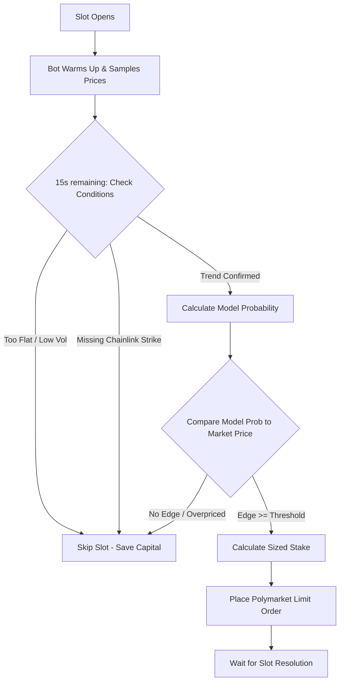

# Polymarket BTC 5-Minute Trading Bot: Beginner's Guide

This guide is designed to help a beginner understand how the Polymarket BTC 5-Minute UP/DOWN bot works, how to configure the strategy settings safely, and how to set up and fund a wallet for live trading.

---

## 1. How the Bot Works

Every 5 minutes, Polymarket hosts a contract: **"Will Bitcoin be UP or DOWN at the end of this 5-minute slot?"**



The bot's job is to:
1. **Determine the Trend:** Sample BTC prices over the first 4 minutes of the slot.
2. **Estimate Probability:** Use a Random Walk CDF (Drift/Diffusion) model to calculate the likelihood of an `UP` or `DOWN` finish based on the distance from the strike price and realized volatility.
3. **Scan the Book:** Check the actual Polymarket order book to see the prices of the `UP` and `DOWN` tokens.
4. **Verify Edge:** Only trade if the model probability suggests the token is underpriced compared to the market.

---

## 2. Setting Up Your Wallet (Step-by-Step)

To trade with real money (`MODE=live`), you must provide a funded Web3 wallet. The bot uses two addresses: your **Private Key** (used to sign trades) and the **Funder Address** (where the USDC collateral is held on Polymarket).

### Step 1: Create a Wallet
1. Download a Web3 Wallet extension (like [MetaMask](https://metamask.io/) or [Rabby Wallet](https://rabby.io/)).
2. Create a new wallet and securely write down your **Secret Recovery Phrase** (seed phrase).
3. Copy your wallet's public Ethereum address (starts with `0x`).

### Step 2: Export Your Private Key
The bot needs to sign orders programmatically using your wallet's private key.
> [!CAUTION]
> **NEVER** share your Private Key or commit it to GitHub. Anyone with this key can steal your funds. Keep it strictly inside your local `.env` file.
1. In MetaMask/Rabby, go to account details and click **Export Private Key**.
2. Copy the private key (a 64-character hexadecimal string, e.g., `0xabc123...`).

### Step 3: Fund the Wallet on Polygon
Polymarket runs on the **Polygon (Polygon POS)** network. You need two assets:
1. **USDC (USDC.e or Native USDC):** Used as collateral to buy contracts.
2. **POL (formerly MATIC):** Used to pay transaction gas fees (usually less than $0.01 per transaction).
*Buy POL and USDC on an exchange (Coinbase, Binance, etc.) and withdraw them to your wallet address using the **Polygon** network.*

### Step 4: Polymarket Wallet Types (`SIGNATURE_TYPE`)
Depending on how you use Polymarket, your wallet structure falls into one of two setups:

| Setup | Wallet Type | config settings | Explanation |
| :--- | :--- | :--- | :--- |
| **Direct Web3 Wallet** (Metamask/Rabby) | **EOA (External Owned Account)** | `SIGNATURE_TYPE=0`<br>`FUNDER_ADDRESS=` same as EOA address | Your private key directly owns the USDC on-chain. You deposit USDC to your normal Ethereum/Polygon address. |
| **Polymarket Account** (Email/Google/Proxy) | **Deposit Smart Wallet (EIP-1271)** | `SIGNATURE_TYPE=3`<br>`FUNDER_ADDRESS=` Polymarket deposit address | Polymarket generated a smart contract wallet for you. You sign orders with your private key, but the USDC sits in Polymarket's contract. |

#### How to find your Polymarket Deposit Address (for Type 3):
1. Log into [Polymarket.com](https://polymarket.com).
2. Click on **Deposit** or your profile.
3. Locate the **Polygon Deposit Address** (e.g. `0x25bc...`). Copy this as your `FUNDER_ADDRESS`.
4. Your MetaMask/Rabby wallet address (associated with the `PRIVATE_KEY` you put in the bot) will act as the signer.

---

## 3. Guide to Strategy Settings

The settings panel controls how aggressively or conservatively the bot behaves. Below is a full explanation of the **Late Scalp** settings.

### Late Scalp (Late Favorites) Parameters

| Setting Name | UI Field Name | Beginner Recommendation | Detailed Explanation |
| :--- | :--- | :--- | :--- |
| **Trade Every 5m Slot** | `LATE_SCALP_EVERY_SLOT` | **Checked (Enabled)** | If checked, the bot will evaluate every single slot. If unchecked, it will only queue a trade if certain mid-slot criteria were met earlier. |
| **Late Min Entry** | `LATE_MIN_ENTRY` | **0.82** (82¢) | The cheapest favorite price you are willing to buy. Skipping anything lower (e.g., 0.60) prevents the bot from buying soft, risky favorites. |
| **Late Max Entry** | `LATE_MAX_ENTRY` | **0.92** (92¢) | The most expensive price you will pay. **Never raise this to 0.96+**. Buying at 0.95+ means a single loss wipes out 19+ wins. Capping at 0.92 protects you from terrible payout odds. |
| **Late Prefer Max** | `LATE_PREFER_MAX` | **0.92** (92¢) | The "sweet spot" price. If the market ask jumps higher than this during a requote, the bot will limit buy at this price instead of chasing it. |
| **Late Min Seconds Left** | `LATE_MIN_SECONDS_LEFT` | **8** seconds | Stop trading if there are fewer than 8 seconds left in the slot. Orders placed with under 8 seconds left are highly likely to fail to execute before the slot closes. |
| **Late Max Seconds Left** | `LATE_MAX_SECONDS_LEFT` | **20** seconds | Start scanning the book and calculating the signal when there are 20 seconds remaining. |
| **Min Favorite Lead** | `MIN_FAVORITE_LEAD` | **0.1** (10%) | The minimum price difference between the favorite contract and the underdog contract. Ensures there is a clear favorite in the order book. |
| **Max Underdog Ask** | `MAX_UNDERDOG_ASK` | **0.42** (42¢) | The maximum price allowed for the opposite side. If the underdog side is too expensive, the book is too close to a 50/50 flip to scalp. |
| **Require Spot Align** | `LATE_SCALP_REQUIRE_SPOT_ALIGN` | **Checked (Enabled)** | **Crucial safety filter.** Ensures the real-time spot price agrees with the book favorite. The bot will never buy an `UP` token if the spot price is actually dropping. |
| **Spot Align Epsilon $** | `SPOT_ALIGN_EPSILON $` | **10.0** ($10) | Allows the spot price to be up to $10 below the strike price and still trade UP (or vice versa), accounting for minor bid/ask spreads. |
| **Late Requote Before Fill** | `LATE_SCALP_REQUOTE` | **Checked (Enabled)** | Re-scans the book and updates pricing right before sending the order to prevent buying a spiked price. |
| **Keep First Ask** | `LATE_SCALP_KEEP_FIRST_ASK` | **Checked (Enabled)** | If the price spikes during requote, the bot keeps your original lower bid price rather than chasing the higher market price. |
| **Pause Windows After Loss** | `PAUSE_LATE_WINDOWS_AFTER_LOSS` | **2** slots | If the bot suffers a loss, it will stop trading for the next 2 slots to prevent trading during chaotic market events or high-volatility spikes. |
| **Late Max Stake $** | `LATE_MAX_STAKE $` | **5.0** ($5.00) | The absolute maximum cash risk per slot. Limits exposure in case of network failures or extreme market moves. |
| **Late Max Spread** | `LATE_MAX_SPREAD` | **0.1** (10%) | Skips trading if the spread between bid and ask is wider than 10¢. Wide spreads indicate illiquid markets. |
| **Late Min Move $** | `LATE_MIN_MOVE $` | **8.0** ($8.00) | The minimum distance (in USD) BTC must have moved from the slot open. **Do not set this lower than $8.00**. A smaller move is noise and can easily reverse in the final seconds. |
| **Late Require Chainlink** | `LATE_REQUIRE_CHAINLINK` | **Checked (Enabled)** | **Mandatory for live money.** Skips trading if the official Chainlink resolution price isn't available for the slot open. Prevents settling disagreements. |
| **Late Min Edge** | `LATE_MIN_EDGE` | **0.02** (2.0%) | The edge the model must have over the market price. **Keep at 0.02**. Setting it to 0.00 removes your safety buffer against execution delays and slippage. |
| **Late Use Edge Sizing** | `LATE_SCALP_USE_EDGE_SIZING` | **Checked (Enabled)** | Scales your bet size dynamically based on the edge. High confidence = slightly larger stake (up to your Max Stake). |

> [!NOTE]
> **Testing Larger Stakes (e.g., $10) in Paper Modes:**
> In simulated trading (`paper` and `paper_live`), you can set your **Bet / Trade $** size to larger values like $10 or $20. The bot dynamically scales up the strategy limits (`LATE_SCALP_MAX_STAKE_USD` and `MID_MAX_STAKE_USD`) to match your chosen bet size so that your orders are not capped at the default $5.00 limit. In real-money `live` mode, strict capital safety caps still apply to protect your funds.

---

## 4. Beginner Deployment Checklist

Follow this workflow to launch safely:

### Phase 1: Simulator Testing (`paper`)
Run the bot offline to make sure it loads your configuration without errors.
```bash
python3 bot.py --mode paper --rounds 50
```
*Open `http://localhost:8000` to review the simulated history in the dashboard.*

### Phase 2: Live Market Testing (`paper_live`)
Run the bot using real-time BTC prices and real order book data, but with **simulated fills** (no money at risk, no private key needed).
```bash
python3 bot.py --mode paper_live --rounds 24
```
*Observe if the bot is skipping flat slots and properly identifying winning trends.*

### Phase 3: Live Money (`live`)
1. Open [.env](file:///c:/Users/warun/Desktop/polymarket-btc-bot/.env) and fill in your keys:
   ```env
   MODE=live
   PRIVATE_KEY=0x...your_private_key...
   FUNDER_ADDRESS=0x...your_polymarket_deposit_address...
   SIGNATURE_TYPE=3
   LIVE_CONFIRM=yes
   ```
2. Start with tiny stakes: set `LATE_MAX_STAKE_USD=5.0` and `FIXED_STAKE_USD=1.0` in the settings dashboard.
3. Run the live command:
   ```bash
   python3 bot.py --mode live --rounds 10
   ```
4. Check your Polymarket dashboard to verify that order creation, execution, and settlement are functioning correctly.
